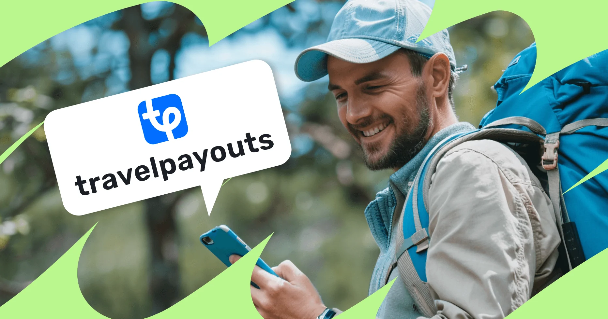
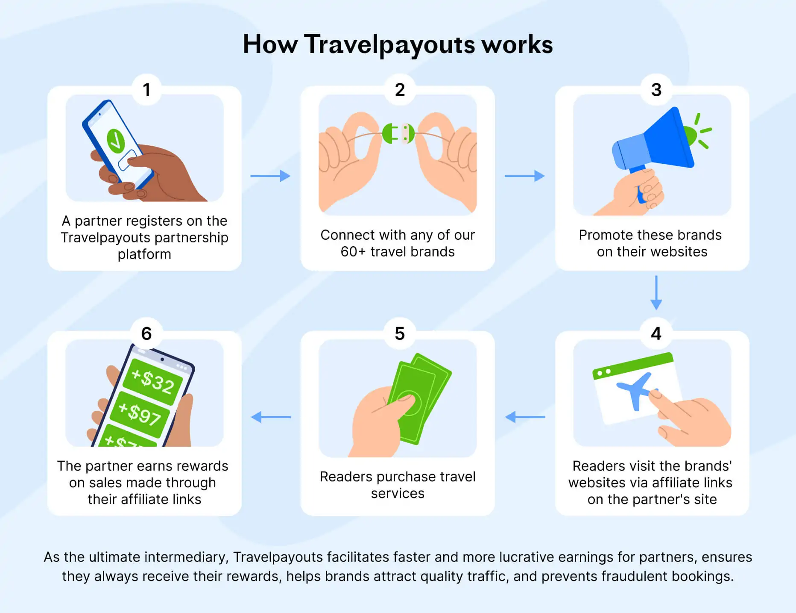

import ProsCons from '../../components/ui/ProsCons.astro';
import FAQ from '../../components/ui/FAQ.astro';
import FAQItem from '../../components/ui/FAQItem.astro';
import CTA from '../../components/ui/CTA.astro';
import travelpayoutsPic1 from '../../assets/blog/travelpayouts/travelpayouts_pic1.webp';
import travelpayoutsPic5 from '../../assets/blog/travelpayouts/travelpayouts_pic5.webp';
import travelpayoutsBgPic3 from '../../assets/blog/travelpayouts/travelpayouts_bg_pic3.svg';

If you run a travel blog, a YouTube channel about backpacking, an Instagram page full of sunset shots from Bali, or even a niche newsletter about budget flights, you've probably asked yourself the same question every travel creator eventually asks: *how do I actually turn this audience into income?*

That's the exact problem Travelpayouts was built to solve. It's one of the largest and longest-running affiliate networks dedicated entirely to the travel industry, connecting content creators with dozens of travel brands — hotels, flights, car rentals, tours, insurance, and more — all through a single dashboard. In this review, we'll break down what Travelpayouts actually offers, how it works, who it's best suited for, and whether it's worth your time in 2026.

## What Exactly Is Travelpayouts?

Travelpayouts is an affiliate marketing platform built specifically around travel. Instead of signing up separately for Booking.com's affiliate program, then Viator's, then a car rental company's, then a travel insurance provider's — each with its own dashboard, login, and payout schedule — Travelpayouts lets you access all of these programs through one unified account.

Think of it as a marketplace of travel affiliate programs. On one side, you have travel brands looking for more bookings. On the other, you have bloggers, YouTubers, and website owners with an audience that's actively planning trips. Travelpayouts sits in the middle, handling the technical and financial plumbing so both sides don't have to deal with each other directly.

The network covers a wide range of travel-related categories, including:

- **Flights** — search widgets and booking links for airfare comparison sites
- **Hotels and accommodation** — from budget hostels to luxury resorts
- **Tours and activities** — city tours, day trips, guided experiences
- **Package tours** — bundled holiday deals
- **Car and bike rentals** — for road-trip content and destination guides
- **Travel insurance** — a surprisingly high-converting niche for safety-conscious travelers
- **Trains and buses** — especially useful for creators covering Europe or Southeast Asia
- **Cruises**
- **Airport transfers and other travel services**

That breadth matters. A lot of affiliate networks in other industries force you to pick one lane. Travel content, on the other hand, naturally touches multiple categories in a single article — a "3 Days in Tokyo" post might mention flights, a hotel recommendation, a guided food tour, and a train pass, all in the same piece. Having one network that covers all of that means you're not juggling four different affiliate logins just to monetize one blog post properly.

<CTA link="https://www.travelpayouts.com/?marker=760685" btnText="Join today" title="Join the Travelpayouts partnership platform" disclaimer="Join 600k partners promoting 90+ travel brands and earn more with Drive AI." bgGradient="linear-gradient(135deg, #006aff, #0088ff)" btnBg="#ffffff" btnColor="#0073ff" bgImage={travelpayoutsPic1.src} />

## How Travelpayouts Actually Works

The mechanics are fairly simple once you understand the flow:

1. **You sign up** for a free Travelpayouts account.
2. **You choose which brands** to promote from the directory — you're not locked into all of them, and different brands have different approval requirements.
3. **You grab affiliate links, banners, or widgets** for the brands you've chosen and place them on your website, in your video descriptions, or in your newsletter.
4. **A reader clicks your link**, gets tracked via a cookie, and if they book something (a flight, a hotel room, a tour), you earn a commission.
5. **Travelpayouts collects the commission from the brand** and pays it out to you — typically once a month, automatically.

What makes this worth mentioning is the payout structure. Rather than making you chase individual programs for payment, everything gets consolidated. You earn from Booking.com, a car rental site, and a tour operator all in the same month, and it shows up as one combined payout instead of three separate ones landing on three different days.

## The Standout Features

### One Dashboard, Every Brand

The single biggest selling point of Travelpayouts is consolidation. Instead of managing ten different affiliate accounts with ten different login credentials, ten different reporting dashboards, and ten different payout schedules, everything lives in one place. You can see which brands are converting, which pages on your site are generating the most clicks, and what your total earnings look like — all without switching tabs.

### LinkSwitcher: Automatic Link Conversion

One of the more clever tools in the Travelpayouts arsenal is LinkSwitcher. If you've been blogging for years and have hundreds of old posts filled with plain, non-monetized links (or worse, links to a competing affiliate network you no longer want to use), manually going back and updating every single one is a nightmare.

LinkSwitcher automates this. It scans your existing links and swaps them out for the correct Travelpayouts affiliate versions — without you having to touch each post individually. You even get control over which brands or which pages get modified, so it's not an all-or-nothing switch. And if you change your mind, you can disable it and your original links come back. 

### Drive: AI-Powered Monetization

More recently, Travelpayouts introduced a tool called Drive, which uses AI to analyze your content and automatically identify monetization opportunities you might have missed — spots in your articles where a relevant affiliate link could be inserted, or moments where a reader is statistically more likely to book something. The pitch is straightforward: less manual optimization work, more revenue captured passively from content you've already published.

### Same-Day Monthly Payouts

Travelpayouts pays out automatically via PayPal or bank transfer, on the same day each month, with no manual withdrawal requests needed. Consistency here builds trust, particularly for creators who treat their blog as an actual income stream rather than a side hobby.

### Human Support, Not Chatbots

Support quality is one of those things you don't appreciate until you desperately need it — a tracking issue, a missing commission, a question about a specific brand's terms. Travelpayouts markets itself around fast, human-staffed support, with response times generally clocking in under half an hour, 24/7.

<CTA link="https://www.travelpayouts.com/?marker=760685" btnText="Let's Go" bgGradient="transparent" btnColor="#ffffff" btnBg="#0062ff" title="Ready to turn your website into income?" disclaimer="One, two, click — and you're in. Lots of website owners are getting paid right this minute. Why not you?" bgImage={travelpayoutsBgPic3.src} theme="light-center" />

## How Much Can You Actually Earn?

This is the question everyone everyone actually cares about, so let's be direct about it.

Earnings on Travelpayouts vary enormously depending on three factors: the commission rate of the specific program, the volume and quality of your traffic, and how well your content converts. Some partners report monthly earnings in the range of a few thousand dollars, but that's far from guaranteed — it reflects established creators with meaningful traffic and well-optimized content, not brand-new bloggers posting their first article.

If you're just starting out, don't expect life-changing income in month one. Travel affiliate marketing, like most affiliate marketing, is a slow burn. It rewards consistent content creation, SEO patience, and audience trust built over months or years. Where Travelpayouts genuinely helps is in removing friction from that process.

## Who Is Travelpayouts Best For?

- **Travel bloggers** are the most obvious fit — anyone writing destination guides, itineraries, or "best of" lists.
- **YouTubers covering travel** can use affiliate links in video descriptions for gear, bookings, and tours.
- **Niche newsletter writers** focused on deals, digital nomad life, or specific regions.
- **Owners of older, content-heavy travel sites** stand to benefit disproportionately from tools like LinkSwitcher and Drive.

## Travelpayouts vs. Going Direct

A fair question is why not just sign up directly with Booking.com's affiliate program, or Viator's, or GetYourGuide's, and skip the middleman entirely?

The honest answer is that conversion rates tend to be identical either way — a booking is a booking, whether it's tracked through Travelpayouts or a direct program, and your actual earnings per sale are generally comparable. What changes is the overhead. Managing five or six direct relationships means five or six sets of login credentials, five or six payout schedules, and five or six sets of terms and reporting quirks to keep track of. Travelpayouts flattens all of that into a single system, and it does so without taking a cut of your commission.

## The Pros and Cons, Summed Up

<ProsCons pros={frontmatter.pros} cons={frontmatter.cons} />

## Final Verdict

For anyone seriously building a travel content brand — whether that's a blog, a YouTube channel, or a well-curated newsletter — Travelpayouts is hard to argue against as a starting point. It doesn't cost anything to try, it doesn't eat into your commissions, and it solves a genuinely annoying logistical problem: managing dozens of separate affiliate relationships one by one.

The tools built around the core network — automated link switching for legacy content, AI-assisted monetization suggestions, consistent human support — show a platform that's actively trying to reduce the busywork of affiliate marketing rather than just being a passive directory of brand links.

Is it a magic button that turns any blog into a five-figure income stream overnight? No. But if you already have travel content, or you're serious about building some, Travelpayouts removes enough friction from the monetization process that it's genuinely worth setting up alongside your content strategy.

<CTA link="https://www.travelpayouts.com/?marker=760685" btnText="Start Earning with Travelpayouts →" size="lg" title="Turn your travel audience into income." bgGradient="linear-gradient(135deg, #006aff, #0088ff)" btnBg="#ffffff" btnColor="#0073ff" floatingImage={travelpayoutsPic5.src} />

---
*This review reflects publicly available information about Travelpayouts as of 2026. Individual results, commission rates, and program terms vary by brand and are subject to change.*
